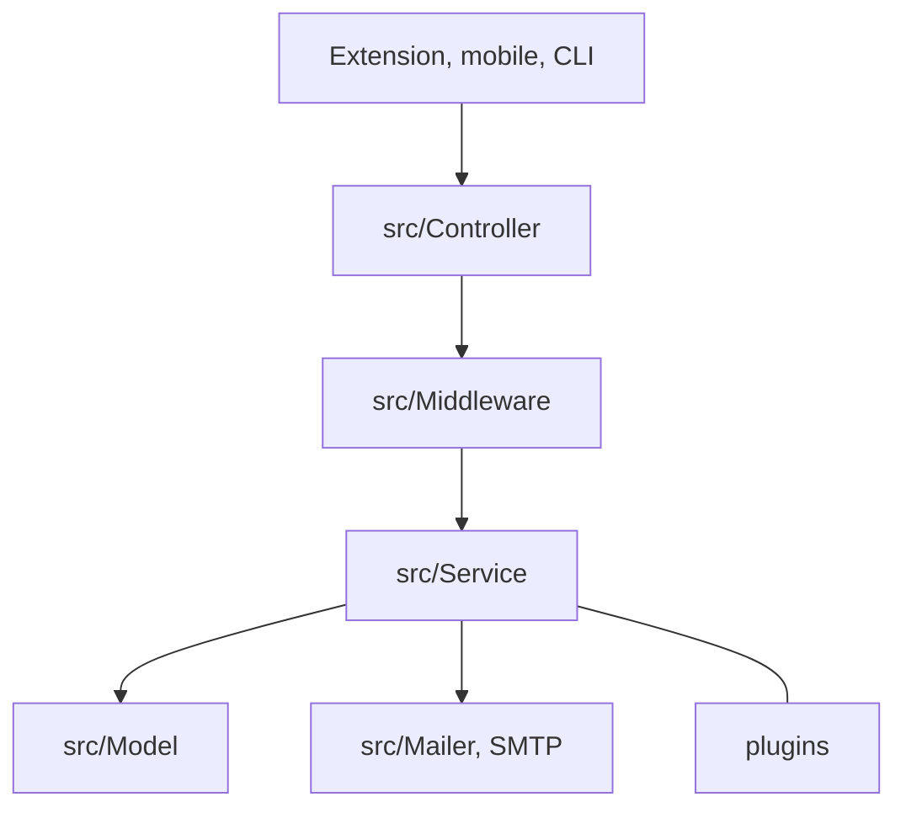

# passbolt/passbolt_api

> Gestionnaire de mots de passe open source pour équipes, avec chiffrement de bout en bout, à héberger soi-même.

## Le problème
Les équipes s'échangent des mots de passe et des secrets par messagerie ou tableur, sans droits ni traçabilité.

## Ce que ça fait vraiment
Serveur d'API en PHP (conventions CakePHP) qui centralise et partage identifiants et secrets entre utilisateurs et groupes. Les clés appartiennent aux utilisateurs (GPG/OpenPGP), avec JWT et authentification multifacteur en plugins. Les clients sont des extensions de navigateur, des applis mobiles et un CLI tiers. Le README affirme qu'il n'y a ni télémétrie ni collecte de données personnelles.

## Comment c'est branché


## Essayer
```bash
# Aucune commande dans le README : l'installation passe par les guides en ligne
# (docker, kubernetes, Ubuntu, Debian, etc.) liés depuis passbolt.com/ce
```

## Coût et pièges
Gratuit en édition communautaire, mais il faut un serveur, une base de données et un serveur SMTP à ta charge. Les clés utilisateurs perdues compliquent la récupération.

## Ce que ce n'est pas
Ce n'est pas une appli à usage direct : l'API seule ne suffit pas, il faut une extension de navigateur ou une appli cliente. L'appli de bureau est annoncée « bientôt » (pré-alpha). Licence AGPL : à vérifier avant tout usage commercial modifié.

## Alternatives
Aucune alternative nommée dans le README.

## Pour toi
À surveiller : utile si ton équipe veut héberger ses secrets (clés d'API, accès cloud) sans SaaS, sans lien direct avec le travail data.

