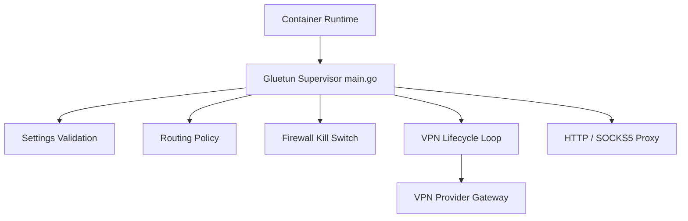

# passteque/gluetun

> Multi-provider VPN client container with kill switch, DNS over TLS and built-in proxies.

## The problem
Routing other containers through a commercial VPN without traffic leaks requires manually configuring routing and the firewall.

## What it actually does
It supports more than 20 VPN providers (Mullvad, ProtonVPN, NordVPN…) over OpenVPN and WireGuard, and AmneziaWG through a custom provider.
A kill switch firewall lets only the VPN and the LAN through.
It includes DNS over TLS with blocking, and HTTP, SOCKS5 and Shadowsocks proxies.
It handles port forwarding (PIA, ProtonVPN) and exposes a control API, a health check and metrics. It can be used as a Kubernetes sidecar.

## How it is wired

## Trying it
The README gives no shell command. It provides an example `docker-compose.yml` and points to the wiki.

## Cost and gotchas
A paid VPN subscription is required. The container requires `NET_ADMIN` and `/dev/net/tun`.

## What it is not
It is not a VPN provider. It is not an enterprise security tool (zero trust, SSO). Only this repository and its wiki are official; other sites are scams according to the README.

## Alternatives
The README names no alternative repository.

## For you
Ignore: a well-made home network or homelab tool, but unrelated to data/AI.
