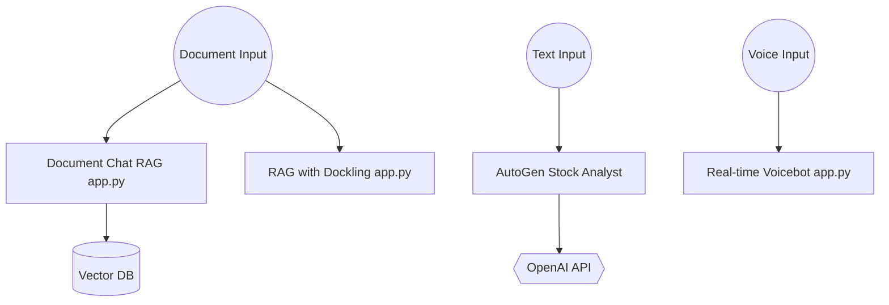

# patchy631/ai-engineering-hub

> A collection of 93+ AI example projects (RAG, agents, MCP, OCR, voice), sorted by difficulty.

## The problem
Learning AI engineering without concrete, runnable examples, scattered across blogs and repos.

## What it actually does
- Each subfolder is a small standalone app (often `app.py`): RAG, local chat, OCR, CrewAI agents, MCP, voice, model comparisons.
- Three levels: beginner, intermediate, advanced (fine-tuning, NotebookLM clone).
- No shared runtime: each project has its own dependencies, its `.env` and its external services.

## How it is wired

## Trying it
No single command documented in the main README: it points to each project. Clone the repo, then open the folder you want and follow its own README.

## Cost and gotchas
Many projects require keys (OpenAI, Cohere, AssemblyAI, BrightData, Firecrawl...); others run locally via Ollama. Quality varies from project to project, 136 open issues.

## What it is not
Not an installable library or a framework. "Production-ready" in the README is no guarantee: these are educational demos.

## Alternatives
The README names no alternative.

## For you
Worth watching: a good pool of RAG/agent/MCP examples to copy for a prototype, but do not look for production-hardened code.
