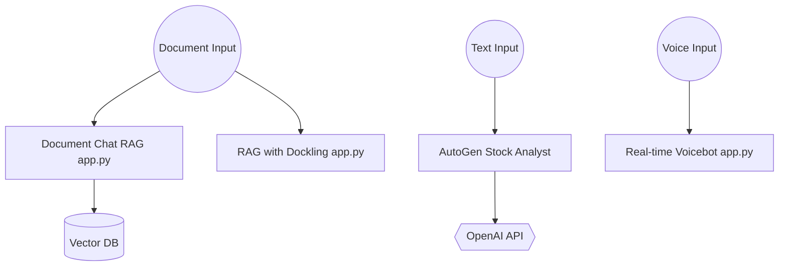

# patchy631/ai-engineering-hub

> Collection de 93+ projets d'exemples IA (RAG, agents, MCP, OCR, voix), classés par difficulté.

## Le problème
Apprendre l'ingénierie IA sans exemples concrets et exécutables, éparpillés entre blogs et dépôts.

## Ce que ça fait vraiment
- Chaque sous-dossier est une petite appli autonome (souvent `app.py`) : RAG, chat local, OCR, agents CrewAI, MCP, voix, comparaisons de modèles.
- Trois niveaux : débutant, intermédiaire, avancé (fine-tuning, NotebookLM clone).
- Pas de runtime commun : chaque projet a ses dépendances, son `.env` et ses services externes.

## Comment c'est branché

## Essayer
Aucune commande unique documentée dans le README principal : il renvoie vers chaque projet. Le dépôt se clone, puis on ouvre le dossier voulu et on suit son propre README.

## Coût et pièges
Beaucoup de projets exigent des clés (OpenAI, Cohere, AssemblyAI, BrightData, Firecrawl...) ; d'autres tournent en local via Ollama. Qualité inégale d'un projet à l'autre, 136 issues ouvertes.

## Ce que ce n'est pas
Pas une bibliothèque installable ni un framework. « Production-ready » dans le README ne vaut pas garantie : ce sont des démos pédagogiques.

## Alternatives
Le README ne nomme aucune alternative.

## Pour toi
À surveiller : bon vivier d'exemples RAG/agents/MCP à copier pour un prototype, sans y chercher du code durci pour la prod.

