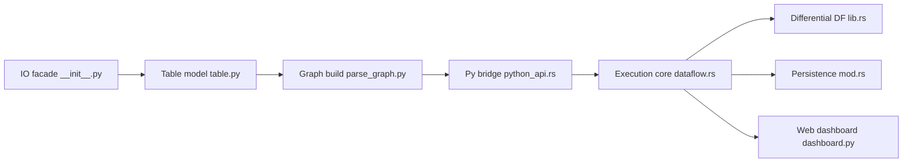

# pathwaycom/pathway

> Python incremental ETL and streaming framework, Rust engine, for real-time pipelines and RAG.

## The problem
Maintaining two codebases, one batch and one streaming, and recomputing everything on each new, late or out-of-order piece of data.

## What it actually does
You describe a graph of tables in Python (`pw.io.*` → filters, joins, windows, reducers → sinks); a Rust engine based on Differential/Timely Dataflow executes it by propagating diffs.
Connectors for Kafka, Postgres, S3, GDrive, SharePoint, Airbyte; state persistence to resume after a crash.
LLM xpack: parsers, splitters, embedders, in-memory vector index, MCP server.
Free version is "at least once"; "exactly once" is reserved for the Enterprise edition.

## How it is wired


## Trying it
```bash
pip install -U pathway
python main.py
pathway spawn --threads 3 python main.py
docker run -it --rm --name my-pathway-app -v "$PWD":/app pathwaycom/pathway:latest python my-pathway-app.py
```

## Cost and gotchas
Python ≥ 3.10, macOS/Linux only (VM on Windows). All state is in memory; distributed Kubernetes and exactly-once go through the Enterprise offering.

## What it is not
Not a managed Spark/Flink: no cluster provided in open source. License not identified by GitHub: read it before commercial use. The performance figures are the vendor's.

## Alternatives
Not documented: the README cites Flink, Spark and Kafka Streams as points of comparison, without a named repository.

## For you
Worth watching for RAG on live documents or pure-Python streaming ETL; check the license first.
