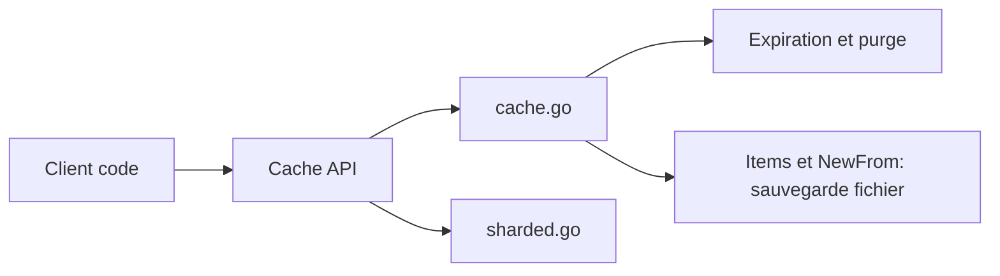

# patrickmn/go-cache

> In-memory key-value cache for Go, with expiration, for applications running on a single machine.

## The problem
Avoiding serializing or sending over the network objects that you simply want to keep in memory for a while.

## What it actually does
It is a goroutine-safe `map[string]interface{}`, with a per-entry lifetime (or none) and periodic purging of expired entries. Any object can be stored. The whole cache can be saved to a file and reloaded (`Items()`, `NewFrom()`), with caveats noted in the docs. The architecture described from the code shows a "sharded" variant in `sharded.go`.

## How it is wired


## Trying it
```bash
go get github.com/patrickmn/go-cache
```
The README then gives a Go example: `cache.New(5*time.Minute, 10*time.Minute)`, `c.Set(...)`, `c.Get(...)`.

## Cost and gotchas
Free. Values come out as `interface{}`: a type assertion on every read. Last push in November 2023, with 80 open issues.

## What it is not
It is not a distributed equivalent of memcached: no sharing between machines, no native persistence.

## Alternatives
The README compares itself to memcached for the principle (an out-of-process cache); no competing library is named.

## For you
Ignore: Go library for a single process, outside your data/AI stack, and with no recent activity.
