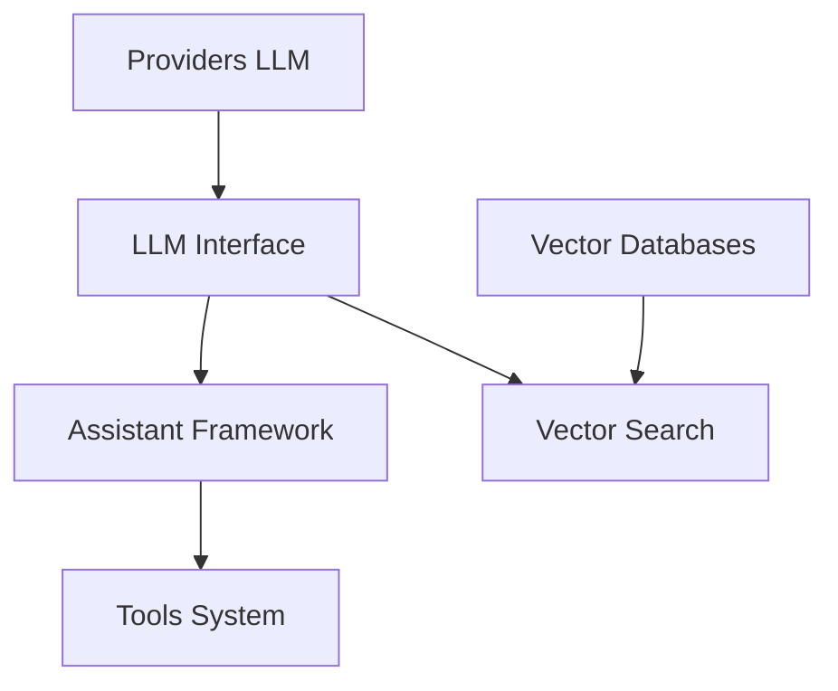

# patterns-ai-core/langchainrb

> Ruby library for LLM applications: RAG, assistants and tools, for Ruby developers.

## The problem
The AI ecosystem is mostly Python: a Ruby or Rails project has to glue together providers, vector databases and prompts itself.

## What it actually does
A single `Langchain::LLM` interface for embeddings, completions and chat. It covers OpenAI, Anthropic, Gemini, Mistral, Ollama and others. It adds prompt templates, structured output parsers, vector search (Chroma, Pinecone, Qdrant, Pgvector, etc.), `Langchain::Assistant` with tools, and a RAGAS evaluation. The companion gems must be added by hand.

## How it is wired


## Trying it
```bash
bundle add langchainrb
gem install langchainrb
bundle exec rake
```
```ruby
require "langchain"
llm = Langchain::LLM::OpenAI.new(api_key: ENV["OPENAI_API_KEY"])
```

## Cost and gotchas
API keys from providers or services (SerpApi, NewsApi...) are at your expense. Each backend's dependencies must be installed separately. Streaming is not supported everywhere.

## What it is not
Not a full equivalent of Python LangChain. The README itself points out a weak spot: `RubyCodeInterpreter` calls for a better solution. No hosted service.

## Alternatives
- langchainrb_rails: deeper Rails integration, cited in the README.

## For you
Adopt it if your service is in Ruby: MIT, a common interface across providers and vector databases; otherwise the Python ecosystem remains richer.
