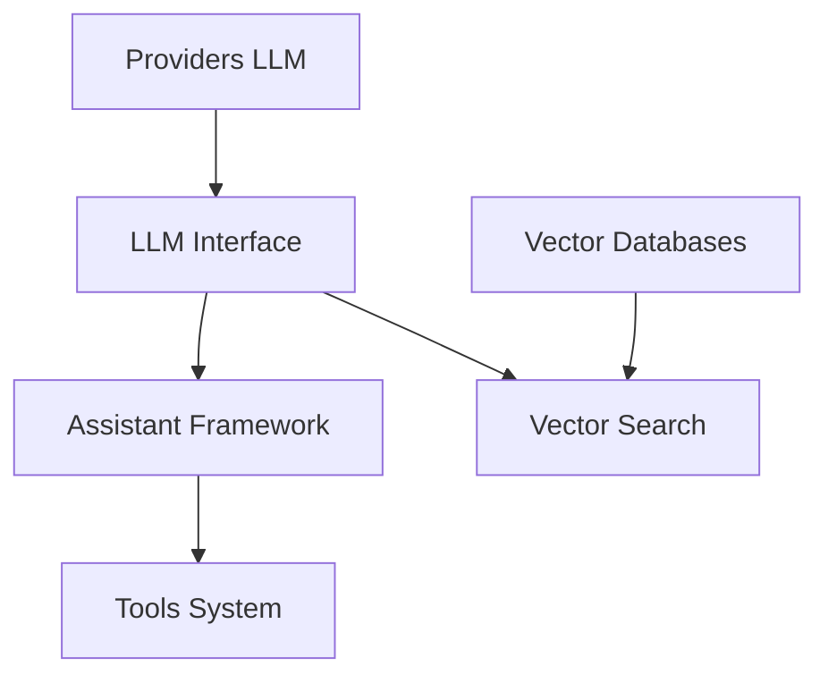

# patterns-ai-core/langchainrb

> Bibliothèque Ruby pour applications LLM : RAG, assistants et outils, pour développeurs Ruby.

## Le problème
Écosystème IA surtout Python : un projet Ruby ou Rails doit recoller lui-même fournisseurs, bases vectorielles et prompts.

## Ce que ça fait vraiment
Une interface unique `Langchain::LLM` pour embeddings, complétions et chat. Elle couvre OpenAI, Anthropic, Gemini, Mistral, Ollama et d'autres. Elle ajoute gabarits de prompts, parseurs de sortie structurée, recherche vectorielle (Chroma, Pinecone, Qdrant, Pgvector, etc.), `Langchain::Assistant` avec outils, et une évaluation RAGAS. Les gems annexes sont à ajouter à la main.

## Comment c'est branché


## Essayer
```bash
bundle add langchainrb
gem install langchainrb
bundle exec rake
```
```ruby
require "langchain"
llm = Langchain::LLM::OpenAI.new(api_key: ENV["OPENAI_API_KEY"])
```

## Coût et pièges
Clés d'API des fournisseurs ou des services (SerpApi, NewsApi...) à ta charge. Les dépendances de chaque backend sont à installer séparément. Le streaming n'est pas géré partout.

## Ce que ce n'est pas
Pas un équivalent complet de LangChain Python. Le README pointe lui-même un point faible : `RubyCodeInterpreter` exige une meilleure solution. Pas de service hébergé.

## Alternatives
- langchainrb_rails : intégration Rails plus poussée, citée dans le README.

## Pour toi
À adopter si ton service est en Ruby : MIT, interface commune aux fournisseurs et bases vectorielles ; sinon l'écosystème Python reste plus fourni.

