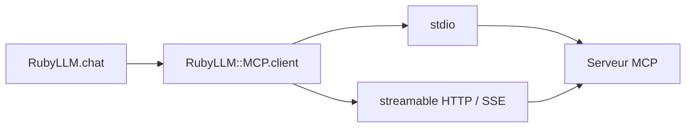

# patvice/ruby_llm-mcp

> Ruby client for the MCP protocol, plugged into RubyLLM, to use tools, resources and prompts.

## The problem
Plugging MCP servers into RubyLLM conversations requires transport, authentication and tool-conversion code.

## What it actually does
- Converts MCP tools into RubyLLM tools; also handles typed resources and prompts.
- `stdio`, streamable HTTP and SSE transports; MCP specification 2025-06-18 stable, 2026-01-26 draft optional.
- OAuth 2.1 (PKCE, dynamic registration), with Rails generators for per-user connections.
- Native `:ruby_llm` adapter, or adapter for the official `mcp` SDK.

## How it is wired
Simplified diagram based on the sheet, no diagram provided.


## Trying it
```bash
bundle install
rails generate ruby_llm:mcp:install
rails generate ruby_llm:mcp:oauth:install User
```
Add `gem "ruby_llm-mcp"` to the Gemfile.

## Cost and gotchas
The model key (for example `OPENAI_API_KEY`) is at your expense. A Ruby environment and RubyLLM are required; MCP servers launched via `bunx` require Bun.

## What it is not
Not an MCP server: it consumes existing servers. Not usable outside Ruby.

## Alternatives
- The official `mcp` SDK (gem), usable as an optional adapter.

## For you
Ignore if your stack is Python: it is a Ruby connector, useful only to those developing with RubyLLM.
