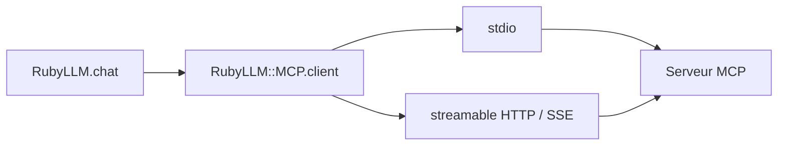

# patvice/ruby_llm-mcp

> Client Ruby du protocole MCP, branché sur RubyLLM, pour utiliser outils, ressources et prompts.

## Le problème
Brancher des serveurs MCP sur des conversations RubyLLM demande du code de transport, d'authentification et de conversion d'outils.

## Ce que ça fait vraiment
- Convertit les outils MCP en outils RubyLLM ; gère aussi ressources et prompts typés.
- Transports `stdio`, HTTP en flux et SSE ; spécification MCP 2025-06-18 stable, brouillon 2026-01-26 en option.
- OAuth 2.1 (PKCE, enregistrement dynamique), avec générateurs Rails pour connexions par utilisateur.
- Adaptateur natif `:ruby_llm`, ou adaptateur du SDK officiel `mcp`.

## Comment c'est branché
Schéma simplifié d'après la fiche, sans diagramme fourni.


## Essayer
```bash
bundle install
rails generate ruby_llm:mcp:install
rails generate ruby_llm:mcp:oauth:install User
```
Ajouter `gem "ruby_llm-mcp"` au Gemfile.

## Coût et pièges
La clé du modèle (par exemple `OPENAI_API_KEY`) est à ta charge. Il faut un environnement Ruby et RubyLLM ; les serveurs MCP lancés via `bunx` demandent Bun.

## Ce que ce n'est pas
Pas un serveur MCP : il consomme des serveurs existants. Pas utilisable hors Ruby.

## Alternatives
- Le SDK officiel `mcp` (gem), utilisable comme adaptateur optionnel.

## Pour toi
À ignorer si ta stack est Python : c'est un connecteur Ruby, utile uniquement à qui développe avec RubyLLM.

