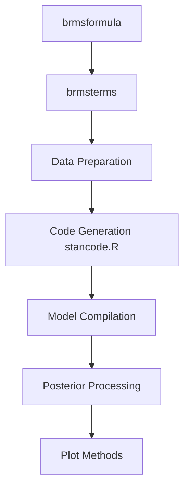

# paul-buerkner/brms

> R package for fitting multilevel Bayesian models with Stan, using an lme4-style formula syntax.

## The problem
Writing Stan code by hand for multilevel models is slow and error-prone.

## What it actually does
`brm()` translates an R formula into Stan code, compiles it and runs MCMC sampling. Many distribution families (count, survival, ordinal, mixture), explicit priors, prediction, LOO comparison, plots and predictive checks.

## How it is wired


## Trying it
```r
install.packages("brms")
library(brms)
fit1 <- brm(count ~ zAge + zBase * Trt + (1|patient),
            data = epilepsy, family = poisson())
summary(fit1)
```

## Cost and gotchas
Free, but it needs a C++ compiler (Rtools on Windows, Xcode on Mac). The first compilation is unavoidable; `update` avoids recompiling afterwards.

## What it is not
Not Python: it is an R package. Not fast on the first fit. The README notes that LOO validation may require refitting the model several times.

## Alternatives
- rstanarm: precompiled code, so no compiler needed, but less flexible.

## For you
Worth watching: a reference for Bayesian modelling in R, useful in applied statistics, less so for a Python MLOps pipeline.
