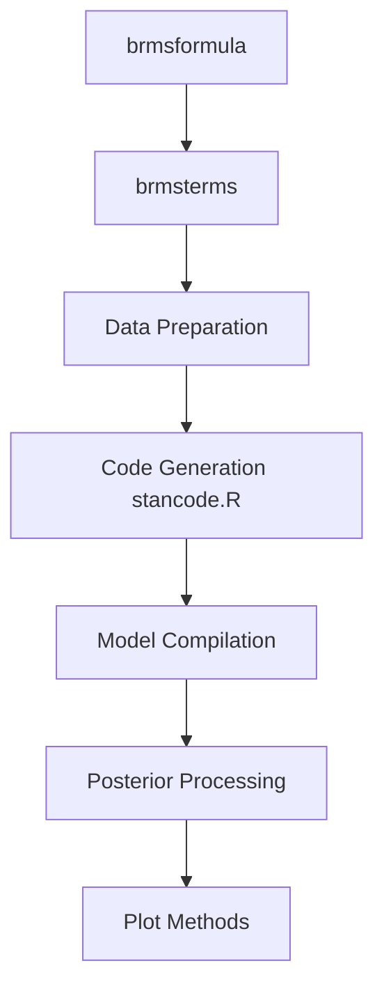

# paul-buerkner/brms

> Paquet R pour ajuster des modèles bayésiens multiniveaux avec Stan, en syntaxe de formule type lme4.

## Le problème
Écrire à la main du code Stan pour des modèles multiniveaux est long et source d'erreurs.

## Ce que ça fait vraiment
`brm()` traduit une formule R en code Stan, le compile et lance l'échantillonnage MCMC. Nombreuses familles de lois (comptage, survie, ordinal, mélange), priors explicites, prédiction, comparaison par LOO, graphiques et vérifications prédictives.

## Comment c'est branché


## Essayer
```r
install.packages("brms")
library(brms)
fit1 <- brm(count ~ zAge + zBase * Trt + (1|patient),
            data = epilepsy, family = poisson())
summary(fit1)
```

## Coût et pièges
Gratuit, mais il faut un compilateur C++ (Rtools sous Windows, Xcode sous Mac). La première compilation est incompressible ; `update` évite de recompiler ensuite.

## Ce que ce n'est pas
Pas du Python : c'est un paquet R. Pas rapide au premier ajustement. Le README signale que la validation LOO peut demander de refitter le modèle plusieurs fois.

## Alternatives
- rstanarm : code précompilé, donc pas de compilateur, mais moins flexible.

## Pour toi
À surveiller : référence pour la modélisation bayésienne en R, utile en statistique appliquée, moins pour un pipeline MLOps en Python.

