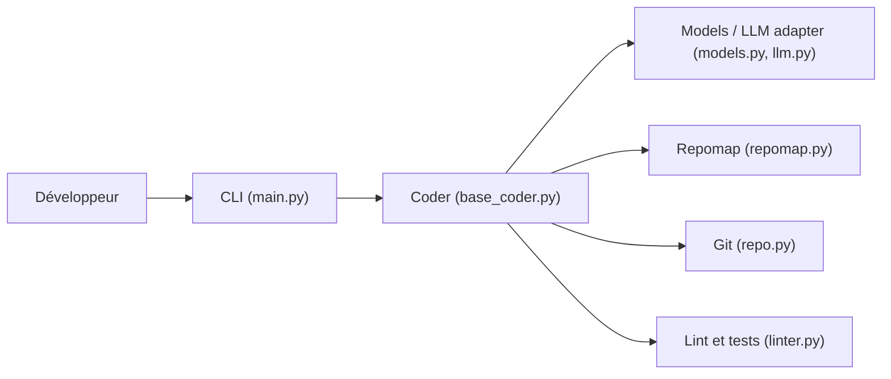

# paul-gauthier/aider

> Terminal programming assistant that edits your Git repository with an LLM, for developers.

## The problem
Copy-pasting code between an LLM chat and the repository is slow and loses the project's context.

## What it actually does
- Builds a map of the code (repomap) to give the model context, even on large repositories.
- Asks the LLM for changes, applies them in several edit formats (block, unified diff, patch) and commits automatically with Git.
- Runs the linter and tests after each change and can fix the errors.
- Works with cloud models (Claude, DeepSeek, OpenAI) or local ones; adds voice, images, web pages, and a watch mode for the IDE.

## How it is wired


## Trying it
```bash
python -m pip install aider-install
aider-install
cd /to/your/project
aider --model deepseek --api-key deepseek=<key>
aider --model sonnet --api-key anthropic=<key>
aider --model o3-mini --api-key openai=<key>
```

## Cost and gotchas
LLM calls are billed by your provider (API key). It commits automatically: review the Git history. 1,902 open issues. The README mentions usage analytics statistics (analytics module); not detailed here.

## What it is not
Not an IDE nor an autonomous agent: you stay in the loop, in the terminal. No model provided: without a key or a local model, nothing runs. The quotes in the README are testimonials, not measurements.

## Alternatives
No alternative named in the README.

## For you
Adopt: an installed, auditable tool (Apache-2.0, activity in May 2026) that integrates with Git and accepts local models; the cost depends on the chosen model.
