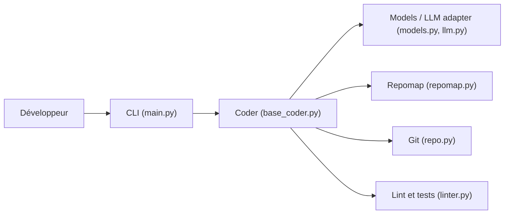

# paul-gauthier/aider

> Assistant de programmation en terminal qui édite ton dépôt Git avec un LLM, pour les développeurs.

## Le problème
Copier-coller du code entre un chat LLM et le dépôt est lent et perd le contexte du projet.

## Ce que ça fait vraiment
- Construit une carte du code (repomap) pour donner du contexte au modèle, même sur de gros dépôts.
- Demande au LLM des modifications, les applique en plusieurs formats d'édition (bloc, diff unifié, patch) et commit automatiquement avec Git.
- Lance linter et tests après chaque changement et peut corriger les erreurs.
- Fonctionne avec des modèles cloud (Claude, DeepSeek, OpenAI) ou locaux ; ajoute voix, images, pages web, mode watch pour l'IDE.

## Comment c'est branché


## Essayer
```bash
python -m pip install aider-install
aider-install
cd /to/your/project
aider --model deepseek --api-key deepseek=<key>
aider --model sonnet --api-key anthropic=<key>
aider --model o3-mini --api-key openai=<key>
```

## Coût et pièges
Les appels au LLM sont facturés par ton fournisseur (clé d'API). Il commit automatiquement : relire l'historique Git. 1 902 issues ouvertes. Le README mentionne des statistiques d'analytique d'usage (module analytics) ; non détaillé ici.

## Ce que ce n'est pas
Pas un IDE ni un agent autonome : tu restes dans la boucle, en terminal. Pas de modèle fourni : sans clé ou modèle local, rien ne tourne. Les citations du README sont des témoignages, pas des mesures.

## Alternatives
Aucune alternative nommée dans le README.

## Pour toi
À adopter : outil installé, auditable (Apache-2.0, activité en mai 2026) qui s'intègre à Git et accepte des modèles locaux ; le coût dépend du modèle choisi.

