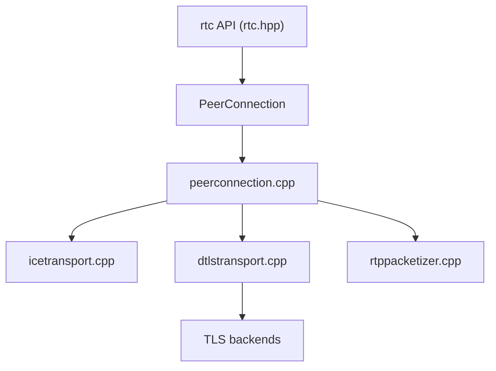

# paullouisageneau/libdatachannel

> Standalone C++ library for WebRTC (data channels, media) and WebSocket, with a C API.

## The problem
Making a native application talk to a browser peer to peer without embedding Google's heavy WebRTC library.

## What it actually does
C++ API (`rtc::PeerConnection`, `DataChannel`, `Track`, `WebSocket`) modeled on JavaScript, with a C binding. ICE, DTLS, SCTP, SRTP stack; TLS via GnuTLS, Mbed TLS or OpenSSL; ICE via libjuice or libnice. RTP packetization for H.264, H.265, VP8, AV1. Bindings for Rust, Node.js, WebAssembly, Unity.

## How it is wired
Diagram based on the code diagram.



## Trying it
```bash
# README : voir BUILDING.md pour la compilation.
# Exemple d'API : rtc::PeerConnection pc(config);
```

## Cost and gotchas
Free, MPL-2.0 license (file-level copyleft, not listed among the alerts). C++ build with dependencies as submodules; you must provide your own signaling server.

## What it is not
Not a ready-to-use video conferencing solution nor an SFU server; signaling is left to the application.

## Alternatives
No alternative named in the README (it compares itself to Google's reference library).

## For you
Worth watching if you want to carry real-time streams (sensors, video) to a native application; otherwise of little use.
