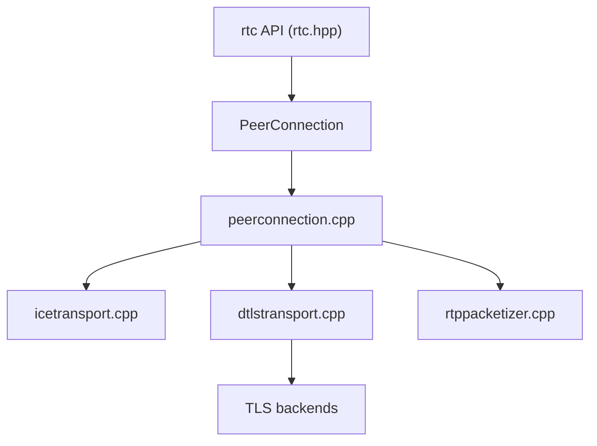

# paullouisageneau/libdatachannel

> Bibliothèque C++ autonome de WebRTC (canaux de données, médias) et WebSocket, avec API en C.

## Le problème
Faire dialoguer une application native avec un navigateur en pair à pair sans embarquer la lourde bibliothèque WebRTC de Google.

## Ce que ça fait vraiment
API C++ (`rtc::PeerConnection`, `DataChannel`, `Track`, `WebSocket`) calquée sur le JavaScript, avec liaison C. Pile ICE, DTLS, SCTP, SRTP ; TLS via GnuTLS, Mbed TLS ou OpenSSL ; ICE via libjuice ou libnice. Paquetage RTP H.264, H.265, VP8, AV1. Liaisons Rust, Node.js, WebAssembly, Unity.

## Comment c'est branché
Schéma d'après le diagramme du code.



## Essayer
```bash
# README : voir BUILDING.md pour la compilation.
# Exemple d'API : rtc::PeerConnection pc(config);
```

## Coût et pièges
Gratuit, licence MPL-2.0 (copyleft de fichier, non listée parmi les alertes). Compilation C++ avec dépendances en sous-modules ; il faut fournir son propre serveur de signalisation.

## Ce que ce n'est pas
Pas une solution de visioconférence prête à l'emploi ni un serveur SFU ; le signalement est laissé à l'application.

## Alternatives
Aucune alternative nommée dans le README (il se compare à la bibliothèque de référence de Google).

## Pour toi
À surveiller si tu veux transporter du flux temps réel (capteurs, vidéo) vers une application native ; sinon peu utile.

