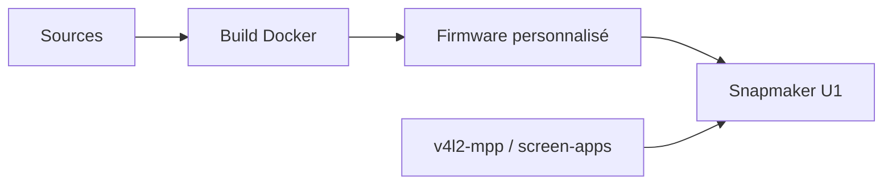

# paxx12/SnapmakerU1-Extended-Firmware

> Alternative firmware for the Snapmaker U1 3D printer, with SSH access and extra features, by a third party.

## The problem
The printer's original firmware is closed: no SSH access and no extensions.

## What it actually does
- Builds a custom firmware for the Snapmaker U1 enabling debug features including SSH.
- Offers prebuilt images in Releases.
- Builds from source via Docker.
- Comes with related projects: v4l2-mpp camera with WebRTC, screen apps, a Prometheus exporter for Klipper, timelapse retrieval.

## How it is wired

## Trying it
No command in the README: download from Releases or follow the external build documentation.

## Cost and gotchas
Free. Any damage is not covered by the warranty. No feature requests or support; bugs must first be validated on the original firmware. 130 open issues.

## What it is not
An independent project, unrelated to Snapmaker. Not a general-purpose software tool.

## Alternatives
No alternative named in the README.

## For you
Ignore: only useful if you own this printer; the Prometheus exporter for Klipper is the only possible link with observability.
