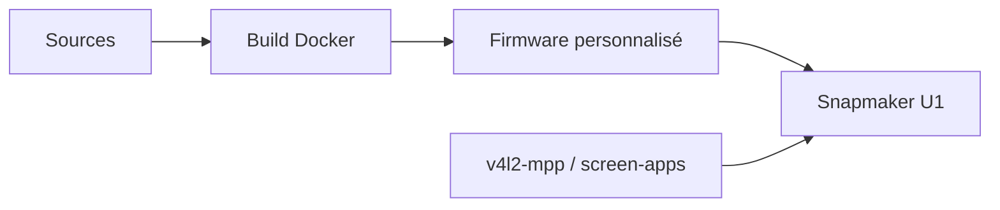

# paxx12/SnapmakerU1-Extended-Firmware

> Firmware alternatif pour l'imprimante 3D Snapmaker U1, avec accès SSH et fonctions en plus, par un tiers.

## Le problème
Le firmware d'origine de l'imprimante est fermé : pas d'accès SSH ni d'extensions.

## Ce que ça fait vraiment
- Construit un firmware personnalisé pour la Snapmaker U1 activant des fonctions de debug dont SSH.
- Propose des images précompilées dans Releases.
- Compilation depuis les sources via Docker.
- S'accompagne de projets liés : caméra v4l2-mpp avec WebRTC, apps d'écran, exporteur Prometheus pour Klipper, récupération de timelapses.

## Comment c'est branché

## Essayer
Pas de commande dans le README : télécharger depuis Releases ou suivre la doc de compilation externe.

## Coût et pièges
Gratuit. Dommages éventuels non couverts par la garantie. Pas de demandes de fonctionnalités ni de support ; bugs à valider d'abord sur le firmware d'origine. 130 issues ouvertes.

## Ce que ce n'est pas
Projet indépendant, sans lien avec Snapmaker. Pas un outil logiciel généraliste.

## Alternatives
Aucune alternative nommée dans le README.

## Pour toi
Ignorer : utile uniquement si tu possèdes cette imprimante ; l'exporteur Prometheus pour Klipper est le seul lien éventuel avec l'observabilité.

