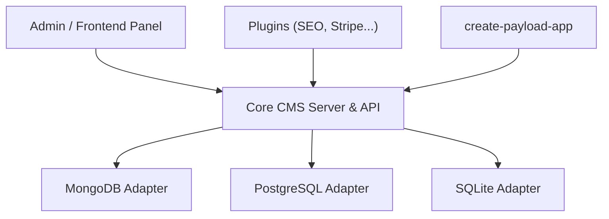

# payloadcms/payload

> A headless CMS and application framework in TypeScript that installs in a Next.js /app directory.

## The problem
A traditional CMS requires a separate service, such as a SaaS platform or older PHP, which can be difficult to extend and manage.

## What it actually does
Provides authentication, versions, and drafts, localization, fine-grained access control, hooks, a Lexical editor, an extensible React admin, and automatic TypeScript types. Includes MongoDB, PostgreSQL, and SQLite adapters; official plugins (SEO, Stripe, forms, multi-tenant, etc.).

## How it is wired


## Trying it
```bash
pnpx create-payload-app@latest
pnpx create-payload-app@latest -t website
npx create-payload-app --example example_name
```

## Cost and gotchas
Free software; hosting and database are your responsibility (one-click deployment on Vercel or Cloudflare). 1,553 open issues. Migration from version 2 to version 3 is planned.

## What it is not
Not a code-free solution: it requires TypeScript and Next.js. Not a data tool.

## Alternatives
No alternative is specified in the README.

## For you
To be aware of: useful for a content website or back-office related to an AI project, but not for the core data/MLOps functions.
