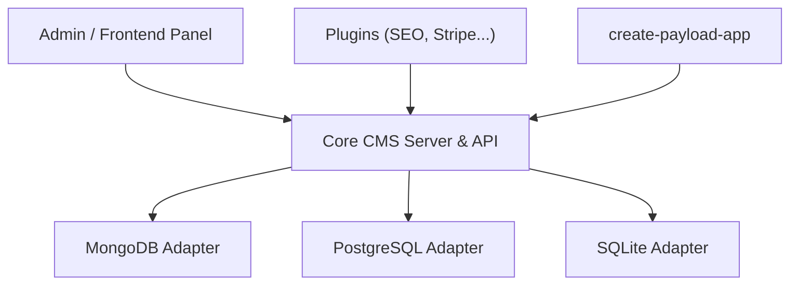

# payloadcms/payload

> CMS headless et framework applicatif en TypeScript qui s'installe dans un dossier /app Next.js.

## Le problème
Un CMS classique impose un service séparé, un SaaS ou du PHP ancien, avec un admin difficile à étendre.

## Ce que ça fait vraiment
Fournit auth, versions et brouillons, localisation, contrôle d'accès fin, hooks, éditeur Lexical, admin React extensible, types TypeScript automatiques. Adaptateurs MongoDB, PostgreSQL, SQLite ; plugins officiels (SEO, Stripe, formulaires, multi-tenant, etc.).

## Comment c'est branché


## Essayer
```bash
pnpx create-payload-app@latest
pnpx create-payload-app@latest -t website
npx create-payload-app --example example_name
```

## Coût et pièges
Logiciel gratuit ; hébergement et base de données à ta charge (déploiement en un clic Vercel ou Cloudflare). 1 553 issues ouvertes. Migration v2 vers v3 à prévoir.

## Ce que ce n'est pas
Pas une solution sans code : il faut du TypeScript et du Next.js. Pas un outil de données.

## Alternatives
Aucune alternative nommée dans le README.

## Pour toi
À surveiller : utile pour un site de contenu ou un back-office autour d'un projet IA, mais hors du cœur data/MLOps.

