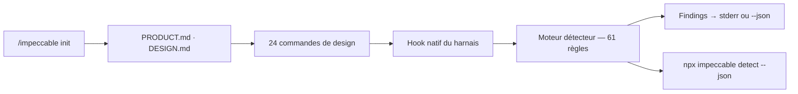

# pbakaus/impeccable

> Skill and CLI for code design guidance, with 61 deterministic rules.

## The problem
All the models were trained on the same SaaS templates: Inter everywhere, with purple-blue gradients, and cards within cards. Without any safeguards, each generated frontend exhibits the same characteristics.

## What it actually does
Install a unique skill `/impeccable` with 24 commands (`craft`, `audit`, `critique`, `polish`, `animate`, `distill`, `live`…). `/impeccable init` creates a durable `PRODUCT.md` file. A binary detector, without an LLM or API key, applies 61 rules to a folder, HTML file, or URL. A native hook (Claude Code, Copilot, Codex, Cursor, Grok Build) triggers the detector on UI file edits.

## How it is wired


## Trying it
```bash
npx impeccable install
npx impeccable detect src/
npx impeccable detect --json .
```

## Cost and gotchas
Free. The launcher downloads a binary stored in `~/.impeccable/bin/`. On Claude Code, the installed hooks run independently of tool approval: therefore, the launcher can download the engine even if the session rejects the command.

## What it is not
The live mode is not suitable for a production website, including those using HTTPS. A clean detection result is an indicator, not proof of visual quality or accessibility. It is not a graphic editor.

## Alternatives
- Anthropic's frontend design: a lighter version of the "Impeccable" design, which was previously used.

## For you
Keep an eye on this if you are creating interfaces with an agent; the LLM-free detector is usable in CI (Continuous Integration) today.
