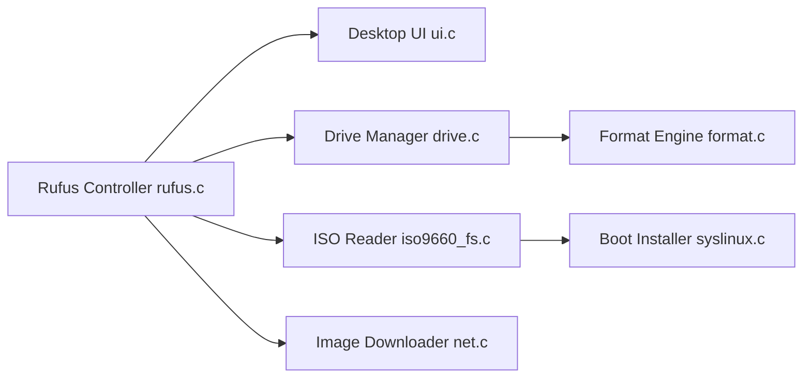

# pbatard/rufus

> Windows utility for formatting USB drives and creating bootable media from ISOs.

## The problem
Creating a bootable USB drive (Windows, Linux, FreeDOS) from an image without a heavy tool.

## What it actually does
Formats as FAT32, NTFS, exFAT, ext2/3, etc.; writes ISOs and disk images (including compressed ones); bypasses TPM/Secure Boot for Windows 11; downloads official Windows ISOs; tests for bad blocks. Portable binary, no installation.

## How it is wired

## Trying it
No usage command: you download the binary from the official site. To build: open the `.sln` with Visual Studio, or `configure`/`make` with MinGW.

## Cost and gotchas
Free. Windows only; ISO downloads go through Microsoft services.

## What it is not
Not a cross-platform tool nor a mass-deployment tool. GPL-3.0: copyleft if you reuse the code.

## Alternatives
No alternative named in the README.

## For you
Keep an eye on it: occasionally useful for setting up a Windows machine or a Linux live system, unrelated to data/AI work.
