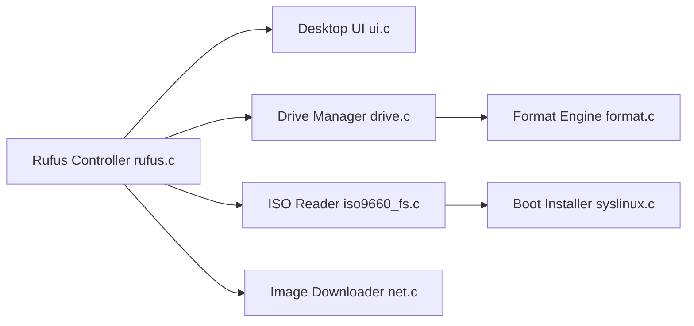

# pbatard/rufus

> Utilitaire Windows pour formater des clés USB et créer des supports de démarrage à partir d'ISO.

## Le problème
Créer une clé USB bootable (Windows, Linux, FreeDOS) à partir d'une image sans outil lourd.

## Ce que ça fait vraiment
Formate en FAT32, NTFS, exFAT, ext2/3, etc. ; écrit des ISO et images disque (y compris compressées) ; contourne TPM/Secure Boot pour Windows 11 ; télécharge des ISO Windows officielles ; teste les blocs défectueux. Binaire portable, sans installation.

## Comment c'est branché

## Essayer
Aucune commande d'usage : on télécharge le binaire depuis le site officiel. Pour compiler : ouvrir le `.sln` avec Visual Studio, ou `configure`/`make` avec MinGW.

## Coût et pièges
Gratuit. Windows uniquement ; le téléchargement d'ISO passe par les services Microsoft.

## Ce que ce n'est pas
Pas un outil multiplateforme ni un outil de déploiement de masse. GPL-3.0 : copyleft si tu réutilises le code.

## Alternatives
Aucune alternative nommée dans le README.

## Pour toi
À surveiller : utile ponctuellement pour monter une machine Windows ou un live Linux, sans lien avec le travail data/IA.

