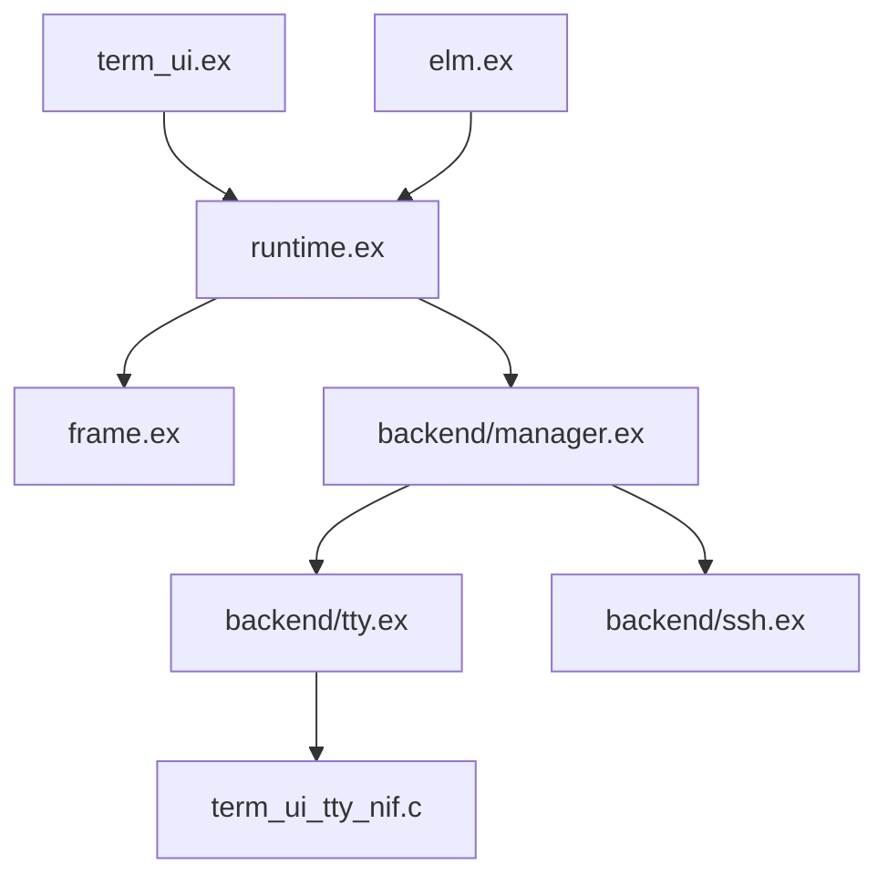

# pcharbon70/term_ui

> Terminal runtime for Elixir based on the Elm architecture, with a single render value, the Frame.

## The problem
Building a robust terminal interface on the BEAM requires a clear architecture and reusable widgets.

## What it actually does
The runtime manages state, commands and rendering; a backend (raw, TTY, SSH, deterministic test) manages the terminal. Pure widgets (tables, input, Markdown, diff, charts) composed into frames. Optional C NIF.

## How it is wired


## Trying it
```bash
# mix.exs : {:term_ui, "~> 2.0.0-rc.1"}
# TermUI.run(Counter)
mix docs
```

## Cost and gotchas
Free. Elixir 1.18.4 and OTP 28 minimum; version 2.0 still a release candidate.

## What it is not
Not tied to Jido: the README states that it does not depend on it. Not yet a final version.

## Alternatives
No alternative named in the README.

## For you
Worth watching: interesting for agent terminal interfaces in Elixir, outside your usual Python stack.
