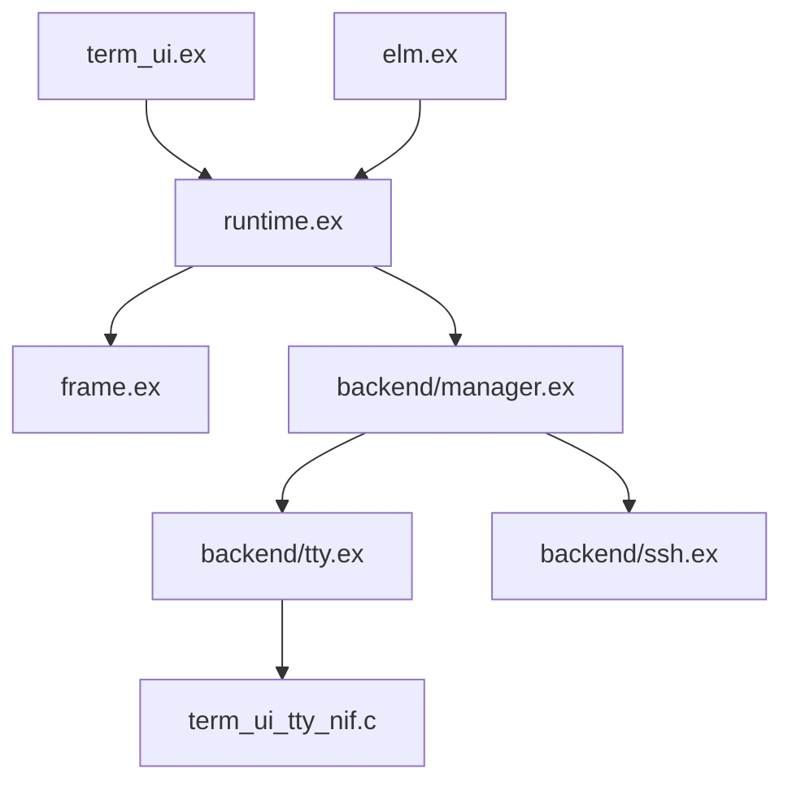

# pcharbon70/term_ui

> Runtime de terminal pour Elixir fondé sur l'architecture Elm, avec une seule valeur de rendu, la Frame.

## Le problème
Construire une interface de terminal robuste sur la BEAM demande une architecture claire et des widgets réutilisables.

## Ce que ça fait vraiment
Le runtime gère état, commandes et rendu ; un backend (raw, TTY, SSH, test déterministe) gère le terminal. Widgets purs (tableaux, saisie, Markdown, diff, graphes) composés en frames. NIF C optionnel.

## Comment c'est branché


## Essayer
```bash
# mix.exs : {:term_ui, "~> 2.0.0-rc.1"}
# TermUI.run(Counter)
mix docs
```

## Coût et pièges
Gratuit. Elixir 1.18.4 et OTP 28 minimum ; version 2.0 encore en release candidate.

## Ce que ce n'est pas
Pas lié à Jido : le README précise qu'il n'en dépend pas. Pas encore une version finale.

## Alternatives
Aucune alternative nommée dans le README.

## Pour toi
À surveiller : intéressant pour des interfaces terminal d'agents en Elixir, hors de ta pile Python habituelle.

