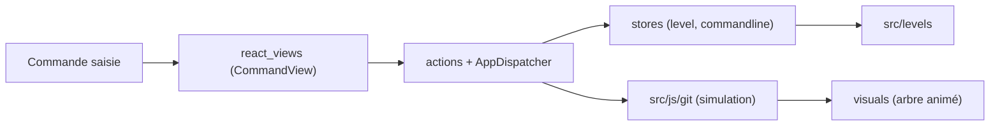

# pcottle/learnGitBranching

> Visual sandbox and progressive levels to learn Git, in the browser.

## The problem
Git on the command line does not show the state of the commit graph, which makes rebase, cherry-pick or remotes hard to understand.

## What it actually does
You type Git commands in a simulated console and the commit tree updates on screen. A sandbox mode (undo, reset, git fakeCreateRemote) and a series of levels, with a "git golf" counter, guide the learning. A level builder lets you create and share levels. Everything runs client-side in JavaScript, with no backend.

## How it is wired


## Trying it
```bash
docker run -p 8080:80 ghcr.io/pcottle/learngitbranching:main
yarn build
yarn test
yarn lint
```

## Cost and gotchas
Free. The provided README is missing the clone/installation part of the development chapter: only a few yarn commands remain readable. Advanced levels already assume some Git knowledge.

## What it is not
Not a real Git: the commands are simulated and only a subset is covered. No server-side progress tracking.

## Alternatives
No alternative cited in the README.

## For you
Adopt as a resource to give to anyone on the team who struggles with rebase or remotes: zero installation and a local mode in Docker.
