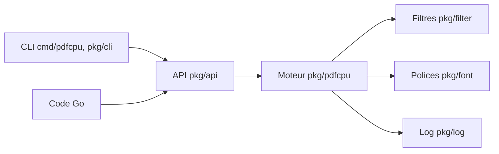

# pdfcpu/pdfcpu

> Go library and command-line tool for processing PDFs, up to PDF 2.0.

## The problem
Merging, splitting, encrypting or validating PDFs in batch without depending on fragile external tools.

## What it actually does
Validation, optimization, merging, splitting, cropping, encryption, watermarks, stamps, resizing, attachments, forms, bookmarks. It also extracts images, fonts and metadata, and checks signature integrity. The CLI calls an API layer (`pkg/api`) in front of a processing engine (`pkg/pdfcpu`), with filters, fonts and logging in separate modules. PDF 2.0 validation is described as "basic".

## How it is wired


## Trying it
```bash
pdfcpu validate input.pdf
pdfcpu merge merged.pdf in1.pdf in2.pdf
pdfcpu validate -vv file.pdf
pdfcpu [command] --help
```

## Cost and gotchas
Free, a single binary. The README asks to submit only PDFs whose content you have the right to share. A PDF that opens in neither Acrobat Reader nor Preview is unlikely to be processed.

## What it is not
It is not a text extractor or an OCR: the README talks about images, fonts and metadata, not textual content. It does not replace a PDF reader.

## Alternatives
No alternative named in the README.

## For you
Adopt it to prepare PDFs before ingestion (merging, splitting, validation, encryption) in batch and with no dependencies: a stable Go binary, with text extraction to be handled elsewhere.
