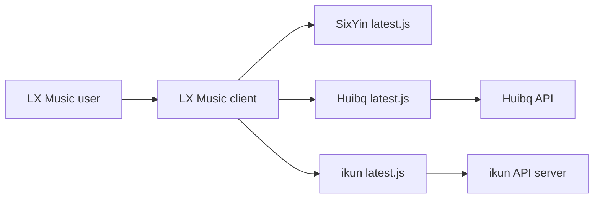

# pdone/lx-music-source

> Collection of music source scripts to import into the LX Music client.

## The problem
The LX Music client needs external sources to obtain audio links.

## What it actually does
Provides `latest.js` scripts (SixYin, Huibq, Flower, LX, ChangQing, HuanYin, ikun, Grass, Juhe, QDY) to import by URL, with raw links and links through acceleration proxies. Some call remote APIs (Migu, Huibq, ikun, Juhe). Content is "sourced from the web" according to the README.

## How it is wired


## Trying it
```bash
# URL à coller dans LX Music :
https://raw.githubusercontent.com/pdone/lx-music-source/main/sixyin/latest.js
```

## Cost and gotchas
Free, but depends on third-party servers you do not control; runs third-party JavaScript inside your client. No license.

## What it is not
Not a player: only sources. Legal status of the content is not stated. README is in Chinese.

## Alternatives
None; the README points to lx-music-desktop, lx-music-mobile, lx-music-sync-server and any-listen (clients/companions).

## For you
Ignore: outside the data/AI scope, unlicensed and dependent on opaque services.
