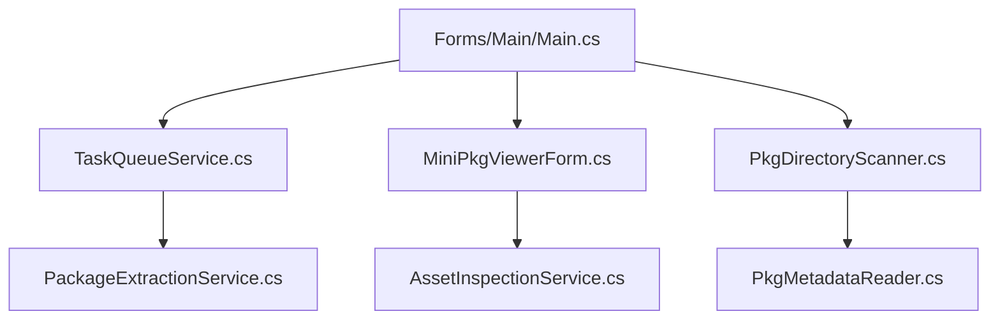

# pearlxcore/PS4PKGTool

> Windows application to manage, inspect and extract a collection of PS4 packages (PKG).

## The problem
A collection of PS4 PKGs is hard to sort, rename and inspect without a tool.

## What it actually does
Scans folders, reads metadata (param.sfo, trophies), renames and organizes PKGs, merges base and update, extracts files. A task queue handles extraction, merging, FFPFSC conversion and installation on shadPS4. An asset viewer opens images, audio, Unity bundles and Unreal PAK.

## How it is wired


## Trying it
```bash
# Aucune commande : télécharger la release Windows (.NET 10 requis).
```

## Cost and gotchas
Windows and .NET 10. Packages generated by OrbisPkgTool are experimental and untested on a jailbroken console. Sending to PS4: Node.js and http-server required.

## What it is not
Not a tool for getting games for free, according to the README. FFPFSC conversion untested on real hardware.

## Alternatives
No alternative named in the README.

## For you
Console game management tool unrelated to data / AI: ignore.
