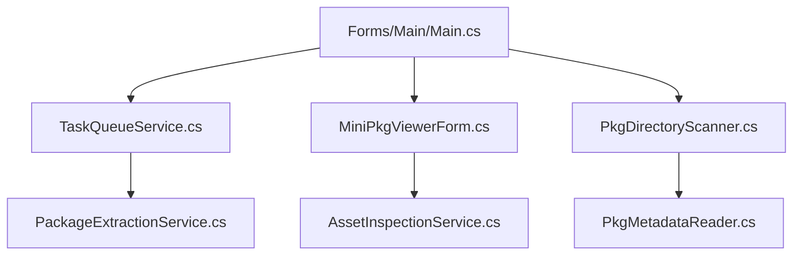

# pearlxcore/PS4PKGTool

> Application Windows pour gérer, inspecter et extraire une collection de paquets PS4 (PKG).

## Le problème
Une collection de PKG PS4 est difficile à trier, renommer et inspecter sans outil.

## Ce que ça fait vraiment
Scanne des dossiers, lit les métadonnées (param.sfo, trophées), renomme et range les PKG, fusionne base et mise à jour, extrait des fichiers. Une file de tâches gère extraction, fusion, conversion FFPFSC et installation sur shadPS4. Un visualiseur d'assets ouvre images, audio, bundles Unity et PAK Unreal.

## Comment c'est branché


## Essayer
```bash
# Aucune commande : télécharger la release Windows (.NET 10 requis).
```

## Coût et pièges
Windows et .NET 10. Les paquets générés par OrbisPkgTool sont expérimentaux et non testés sur console débridée. Envoi vers PS4 : Node.js et http-server nécessaires.

## Ce que ce n'est pas
Pas un outil pour obtenir des jeux gratuitement, d'après le README. Conversion FFPFSC non testée sur matériel réel.

## Alternatives
Aucune alternative nommée dans le README.

## Pour toi
Outil de gestion de jeux console sans lien avec la data / IA : à ignorer.

