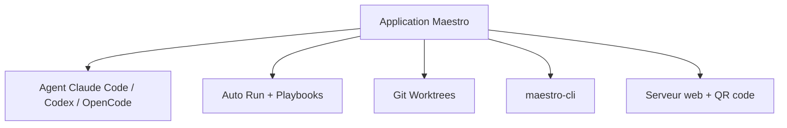

# pedramamini/Maestro

> Desktop application that orchestrates several AI coding agents in parallel, for developers who live on the keyboard.

## The problem
Running several coding agents on several projects at the same time scatters attention across terminals and sessions.

## What it actually does
Acts as a gateway to your installed agents (Claude Code, Codex, OpenCode, Factory Droid, Copilot-CLI, Qwen3 Coder, Oh My Pi) with their permissions and authentication. Offers git worktrees, Auto Run of markdown playbooks (each task in a fresh session), group discussion between agents, a `maestro-cli` CLI and control from the phone via QR code. Tracks cost and usage.

## How it is wired
Simplified diagram based on the sheet, no diagram provided.


## Trying it
```bash
git clone https://github.com/RunMaestro/Maestro.git
cd Maestro
npm install
npm run dev
```

## Cost and gotchas
The software is free, but at least one agent must be installed and authenticated: tokens or subscription at your expense. Remote access goes through a Cloudflare tunnel if you enable it.

## What it is not
Not a coding agent itself: it only launches yours. Not an interactive tool in the sense of a live terminal: each task receives a prompt and returns a response. AGPL license.

## Alternatives
No alternative named in the README.

## For you
Worth watching: useful if you run several coding agents in parallel, but very centered on one author and subject to the AGPL.
