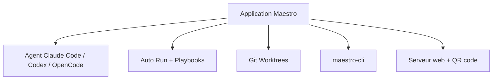

# pedramamini/Maestro

> Application de bureau qui orchestre plusieurs agents de code IA en parallèle, pour développeurs qui vivent au clavier.

## Le problème
Mener plusieurs agents de code sur plusieurs projets en même temps éclate l'attention entre terminaux et sessions.

## Ce que ça fait vraiment
Sert de passerelle vers tes agents installés (Claude Code, Codex, OpenCode, Factory Droid, Copilot-CLI, Qwen3 Coder, Oh My Pi) avec leurs droits et leur authentification. Offre worktrees git, Auto Run de playbooks en markdown (chaque tâche dans une session neuve), discussion de groupe entre agents, CLI `maestro-cli` et pilotage depuis le téléphone par QR code. Suit coût et usage.

## Comment c'est branché
Schéma simplifié d'après la fiche, sans diagramme fourni.


## Essayer
```bash
git clone https://github.com/RunMaestro/Maestro.git
cd Maestro
npm install
npm run dev
```

## Coût et pièges
Le logiciel est gratuit, mais il faut au moins un agent installé et authentifié : tokens ou abonnement à ta charge. L'accès distant passe par un tunnel Cloudflare si tu l'actives.

## Ce que ce n'est pas
Pas un agent de code lui-même : il ne fait que lancer les tiens. Pas un outil intéractif au sens d'un terminal en direct : chaque tâche reçoit un prompt et rend une réponse. Licence AGPL.

## Alternatives
Aucune alternative nommée dans le README.

## Pour toi
À surveiller : utile si tu fais tourner plusieurs agents de code en parallèle, mais très centré sur un auteur et soumis à l'AGPL.

