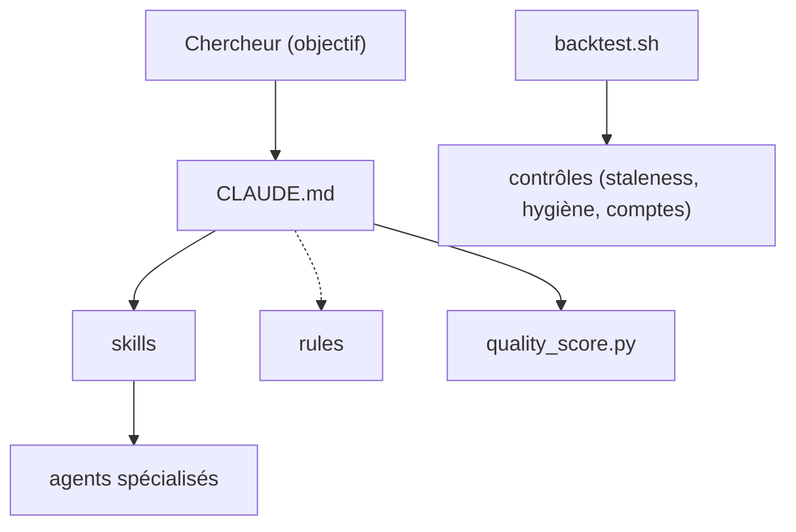

# pedrohcgs/claude-code-my-workflow

> Template to fork for working with Claude Code in academic research: slides, papers, analyses.

## The problem
An assistant with no framework produces uneven work: no specialized review, no check of figures or reproducibility.

## What it actually does
A `CLAUDE.md`, 18 agents, 62 skills, 37 rules and 11 hooks. A `backtest.sh` script runs eleven checks, and a pre-commit hook requires a quality score of at least 80. The skills cover paper review, analysis in R or Stata, Monte Carlo simulations, replication packages and citation checking. A critic-fixer loop repeats until it stabilizes.

## How it is wired


## Trying it
```bash
git clone https://github.com/YOUR_USERNAME/claude-code-my-workflow.git my-project
cd my-project
./scripts/validate-setup.sh
claude
```

## Cost and gotchas
Free, MIT, but it needs Claude Code, git and Python 3; XeLaTeX and Quarto for the demos. The guard hooks are described as a "guardrail", not a lock. The agents consume Claude quota.

## What it is not
Not an autonomous daemon: every loop is launched by you. Designed for economics and political science; the rest needs adapting.

## Alternatives
- clo-author, claudeblattman, MixtapeTools: extensions cited in the guide.

## For you
Worth watching: a good source of ideas for gates, ledgers and multi-agent review for your own Claude Code projects, without adopting it as is.
