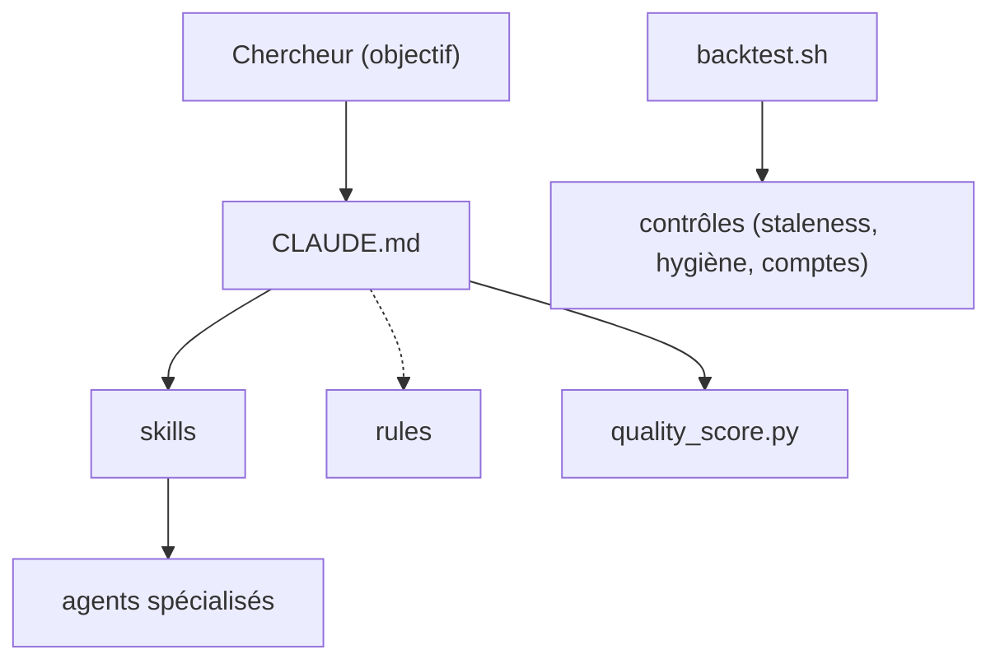

# pedrohcgs/claude-code-my-workflow

> Modèle à forker pour travailler avec Claude Code en recherche académique : slides, articles, analyses.

## Le problème
Un assistant sans cadre produit un travail inégal : pas de relecture spécialisée, pas de contrôle des chiffres ni de la reproductibilité.

## Ce que ça fait vraiment
Un `CLAUDE.md`, 18 agents, 62 skills, 37 règles et 11 hooks. Un script `backtest.sh` lance onze contrôles, et un hook de pré-commit exige un score de qualité d'au moins 80. Les skills couvrent revue d'articles, analyse en R ou Stata, simulations Monte Carlo, paquets de réplication et vérification de citations. Une boucle critique-correcteur répète jusqu'à stabilité.

## Comment c'est branché


## Essayer
```bash
git clone https://github.com/YOUR_USERNAME/claude-code-my-workflow.git my-project
cd my-project
./scripts/validate-setup.sh
claude
```

## Coût et pièges
Gratuit, MIT, mais il faut Claude Code, git et Python 3 ; XeLaTeX et Quarto pour les démos. Les hooks de garde sont qualifiés de « garde-fou », pas de verrou. Les agents consomment du quota Claude.

## Ce que ce n'est pas
Pas un démon autonome : chaque boucle est lancée par toi. Pensé pour l'économie et la science politique ; le reste est à adapter.

## Alternatives
- clo-author, claudeblattman, MixtapeTools : extensions citées dans le guide.

## Pour toi
À surveiller : bonne source d'idées de gates, de ledger et de revue multi-agents pour tes propres projets Claude Code, sans l'adopter tel quel.

