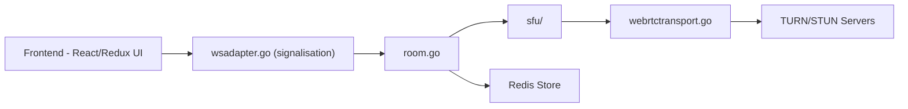

# peer-calls/peer-calls

> Self-hostable WebRTC video call server, with optional SFU, for teams wanting to host their own video meetings.

## The problem
Peer-to-peer video calls saturate upload bandwidth as the number of participants grows, and depend on third-party services.

## What it actually does
Go server (pion/webrtc) and React/Redux/TypeScript client. Two modes: peer-to-peer mesh (default) or SFU (`NETWORK_TYPE=sfu`), which relays the streams. Options: Redis for multiple instances, ICE TCP (experimental), end-to-end encryption via Insertable Streams, Prometheus metrics. A TURN server (coturn) is advised behind a strict NAT.

## How it is wired


## Trying it
```bash
docker run --rm -it -p 3000:3000 ghcr.io/peer-calls/peer-calls:latest
kubectl apply -k github.com/peer-calls/peer-calls
```

## Cost and gotchas
Free; a TURN server and a TLS certificate are needed for network use (browsers block microphone/camera outside localhost without HTTPS). The public instance has limited bandwidth.

## What it is not
Not a managed video conferencing solution with accounts and recording. The README does not document any quantified scaling.

## Alternatives
No alternative named in the README.

## For you
Ignore: useful for self-hosting video meetings, but outside the data/AI/MLOps scope.
