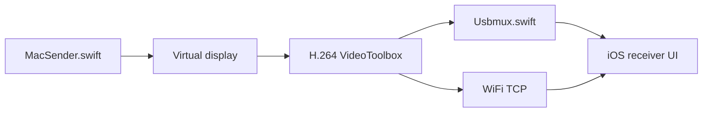

# peetzweg/opendisplay

> Turns an iPhone, an iPad or an old Mac into a second display for a Mac.

## The problem
Sidecar requires the same Apple ID and ignores the iPhone, Duet has moved to a subscription, Luna requires a dongle.

## What it actually does
The Mac creates a virtual display (`CGVirtualDisplay`, a private API), captures it (ScreenCaptureKit), encodes it with hardware H.264 and sends it over TCP, via USB (`usbmuxd`) or WiFi (Bonjour). The receiver decodes it and sends back keystrokes and scrolling, which are injected on the Mac side. No server or account, no analytics according to the README. The protocol is specified in PROTOCOL.md.

## How it is wired


## Trying it
```bash
brew install xcodegen
git clone https://github.com/peetzweg/opendisplay.git
cd opendisplay
./generate.sh
```
Then build via `xcodebuild` (see the README); or use `OpenDisplay.dmg` from the Releases.

## Cost and gotchas
Free. Building requires Xcode 15+ and a free Apple developer account. Screen Recording and Accessibility permissions are required. WiFi encryption: a "caveat" is mentioned, details not documented here. May break on a macOS update.

## What it is not
Neither an App Store app (private API), nor audio-compatible. GPL-3.0: distributed modified versions must remain open.

## Alternatives
Apple Sidecar, Duet Display, Luna Display (cited in the README).

## For you
Ignore: desktop comfort unrelated to data/AI/MLOps, limited to the Apple ecosystem.
