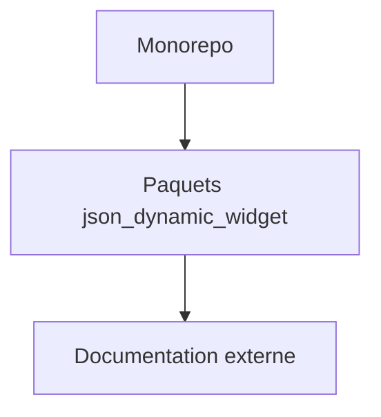

# peiffer-innovations/json_dynamic_widget

> Monorepo of Flutter packages for building widgets from JSON; archived repository.

## The problem
Building a Flutter interface from JSON data without recompiling the application.

## What it actually does
The README contains almost nothing: "monorepo of the json_dynamic_widget suite" and a pointer to the documentation. How it works is not documented here.

## How it is wired
Simplified diagram based on the sheet, no diagram provided.


## Trying it
```bash
# Aucune commande documentée dans le README.
```

## Cost and gotchas
Free. Archived repository: no more fixes. The real requirement is Flutter, missing from the prerequisites list.

## What it is not
Not documentation: the README points elsewhere. Not a maintained project.

## Alternatives
No alternative named in the README.

## For you
Ignore: archived, outside the data/AI scope, and the README has no usable content.
