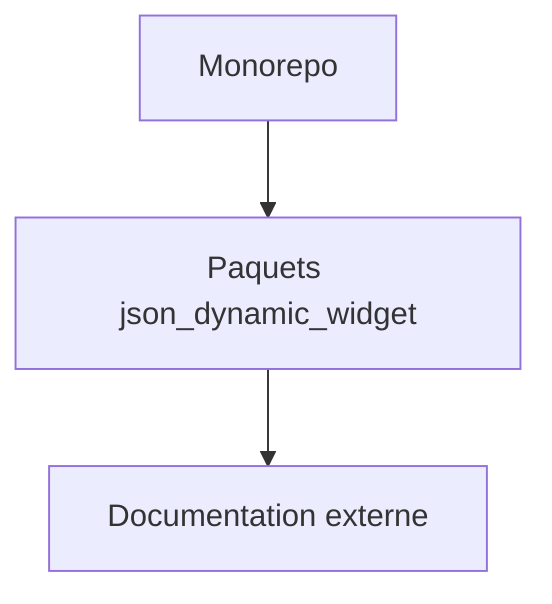

# peiffer-innovations/json_dynamic_widget

> Monorepo de paquets Flutter pour construire des widgets à partir de JSON ; dépôt archivé.

## Le problème
Construire une interface Flutter depuis des données JSON sans recompiler l'application.

## Ce que ça fait vraiment
Le README ne contient presque rien : « monorepo de la suite json_dynamic_widget » et un renvoi vers la documentation. Le fonctionnement n'est pas documenté ici.

## Comment c'est branché
Schéma simplifié d'après la fiche, sans diagramme fourni.


## Essayer
```bash
# Aucune commande documentée dans le README.
```

## Coût et pièges
Gratuit. Dépôt archivé : plus de correctifs. Le besoin réel est Flutter, absent de la liste des prérequis.

## Ce que ce n'est pas
Pas une documentation : le README renvoie ailleurs. Pas un projet maintenu.

## Alternatives
Aucune alternative nommée dans le README.

## Pour toi
À ignorer : archivé, hors périmètre data/IA, et le README est vide de contenu exploitable.

