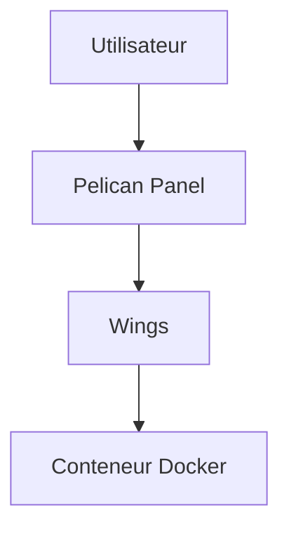

# pelican-dev/panel

> Open source game server control panel, each server in a Docker container via Wings.

## The problem
Hosting and managing game servers for a community requires a clean, isolated web panel.

## What it actually does
Web interface to create and manage servers (Minecraft, SteamCMD games, databases, bots, voice), run in containers isolated by Wings. Limited material: the README is only a few lines and gives neither installation nor architecture.

## How it is wired

Diagram based on the README, no diagram provided.

## Trying it
```bash
# non documenté dans le README fourni
```

## Cost and gotchas
Free; Docker required. AGPL-3.0: obligations if you modify and serve the panel.

## What it is not
Not a documented fork of Pterodactyl here, just "a modern alternative" within its ecosystem.

## Alternatives
Pterodactyl (cited as the originating ecosystem).

## For you
Ignore: game hosting, unrelated to data/AI/MLOps.
