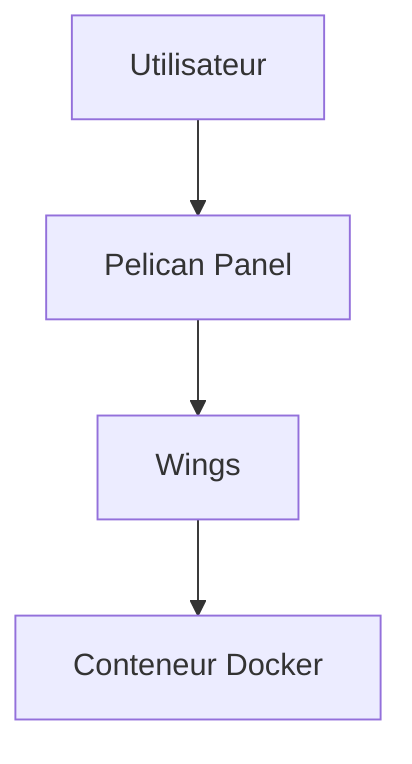

# pelican-dev/panel

> Panneau de contrôle open source de serveurs de jeux, chaque serveur dans un conteneur Docker via Wings.

## Le problème
Héberger et gérer des serveurs de jeux pour une communauté demande un panneau web propre et isolé.

## Ce que ça fait vraiment
Interface web de création et gestion de serveurs (Minecraft, jeux SteamCMD, bases de données, bots, voix), exécutés dans des conteneurs isolés par Wings. Matière limitée : le README tient en quelques lignes et ne donne ni installation ni architecture.

## Comment c'est branché

Schéma d'après le README, pas de diagramme fourni.

## Essayer
```bash
# non documenté dans le README fourni
```

## Coût et pièges
Gratuit ; Docker requis. AGPL-3.0 : obligations si tu modifies et sers le panneau.

## Ce que ce n'est pas
Pas un fork documenté ici de Pterodactyl, juste « une alternative moderne » dans son écosystème.

## Alternatives
Pterodactyl (cité comme écosystème d'origine).

## Pour toi
Ignorer : hébergement de jeux, sans rapport avec data/IA/MLOps.

