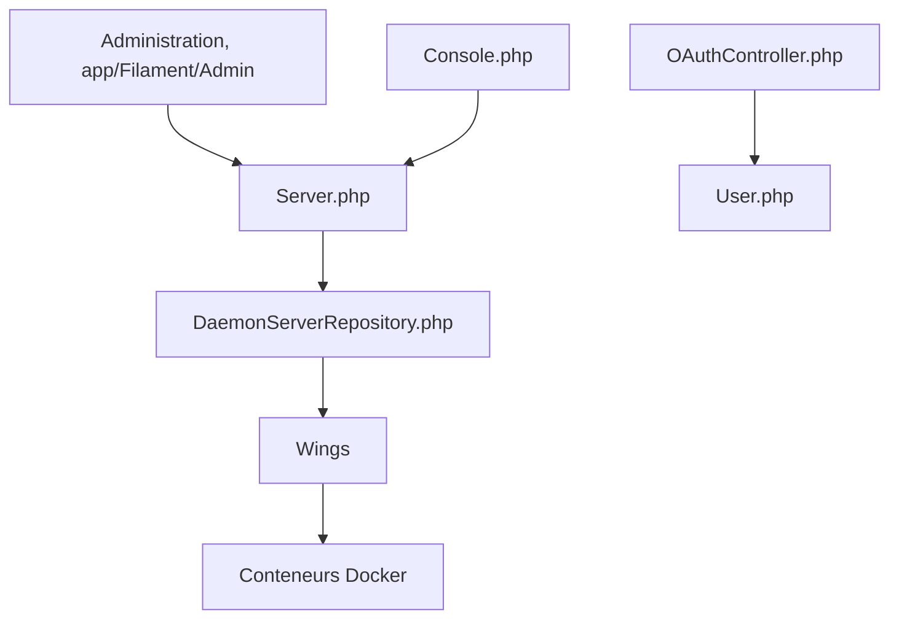

# pelican/panel

> Web panel for managing game servers, isolating them in Docker containers via Wings.

## The problem
Hosting game servers (Minecraft, SteamCMD) for a community means creating and monitoring them one by one.

## What it actually does
A web interface (PHP, Filament) to create and manage servers, and view console and resources. The Wings daemon runs each server in a Docker container. There are client and application APIs and an OAuth login. Very short README: the rest comes from the code.

## How it is wired

## Trying it
No command documented in the README.

## Cost and gotchas
Free, AGPL-3.0: a service exposed over a network must publish its modified sources. Docker and Wings are required on each node; the installation procedure is not in this README.

## What it is not
Not a compute or AI tool. Not enough material to judge the setup here.

## Alternatives
Pterodactyl, cited as the ecosystem of which Pelican is a modern alternative.

## For you
Ignore: game server hosting, unrelated to data or MLOps.
