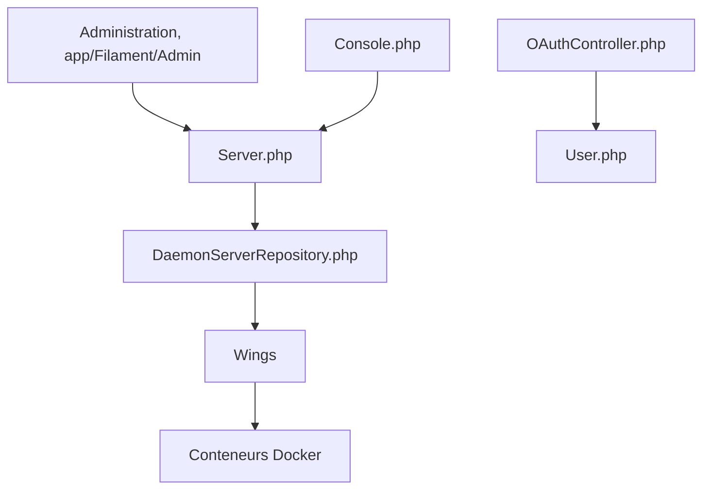

# pelican/panel

> Panneau web de gestion de serveurs de jeu, qui les isole dans des conteneurs Docker via Wings.

## Le problème
Héberger des serveurs de jeu (Minecraft, SteamCMD) pour une communauté demande de les créer et surveiller un par un.

## Ce que ça fait vraiment
Une interface web (PHP, Filament) pour créer et gérer des serveurs, voir console et ressources. Le démon Wings fait tourner chaque serveur dans un conteneur Docker. Il y a des API client et application et une connexion OAuth. README très court : le reste vient du code.

## Comment c'est branché

## Essayer
Aucune commande documentée dans le README.

## Coût et pièges
Gratuit, AGPL-3.0 : un service exposé en réseau doit publier ses sources modifiées. Il faut Docker et Wings sur chaque nœud ; la procédure d'installation n'est pas dans ce README.

## Ce que ce n'est pas
Ce n'est pas un outil de calcul ni d'IA. Pas de matière suffisante pour juger la mise en place ici.

## Alternatives
Pterodactyl, cité comme l'écosystème dont Pelican est une alternative moderne.

## Pour toi
À ignorer : hébergement de serveurs de jeu, sans rapport avec la donnée ni le MLOps.

