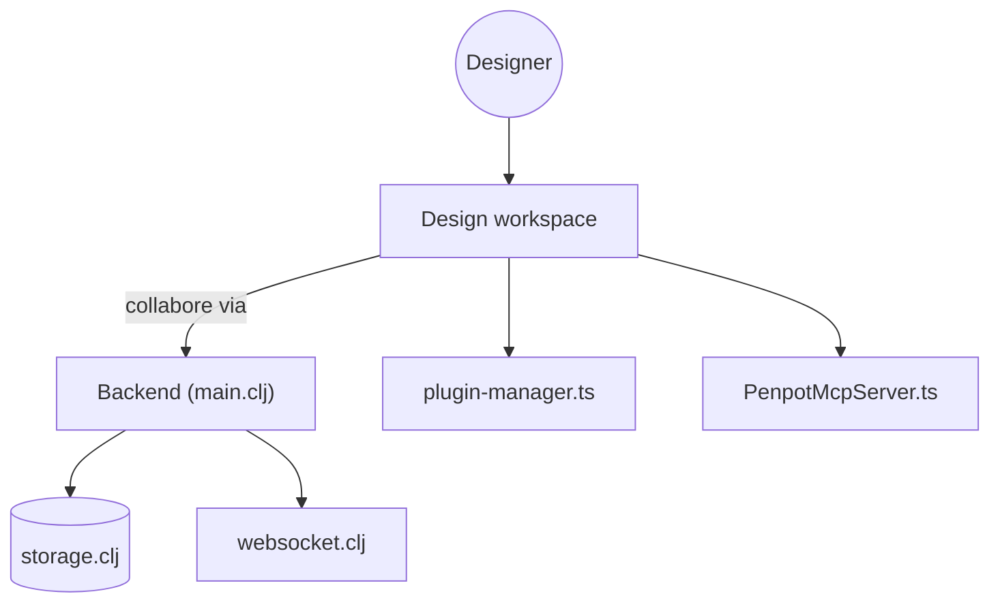

# penpot/penpot

> Open source, self-hostable design platform that turns mockups into code, for product teams.

## The problem
Proprietary design tools lock teams in, and mockups are hard to connect to code.

## What it actually does
Real-time collaborative design editor built on SVG, CSS, HTML and JSON, with components, variants, design tokens, CSS Grid and Flex. An inspect tab delivers the code, and an API and plugins make the workspace programmable. An MCP server connects design, code and AI agents.

## How it is wired

## Trying it
No command documented in the README: installation (Docker, Kubernetes, Elestio) is described on the website.

## Cost and gotchas
Free when self-hosted or on the basic SaaS. The Enterprise edition (admin console, SSO) is paid. The full deployment is heavy: Clojure backend, WebAssembly rendering, plugins.

## What it is not
Not a data visualization tool. It is mainly valuable for the design-to-code chain, not for ML.

## Alternatives
No alternative named in the README.

## For you
Worth watching: the MCP server is the only relevant lead for AI workflows; the rest concerns designers.
