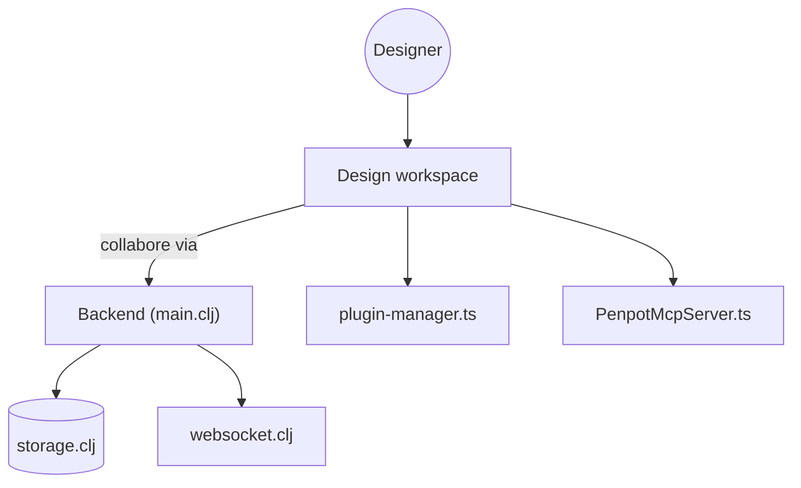

# penpot/penpot

> Plateforme de design open source, auto-hébergeable, qui traduit les maquettes en code, pour équipes produit.

## Le problème
Les outils de design propriétaires enferment les équipes, et les maquettes sont difficiles à relier au code.

## Ce que ça fait vraiment
Éditeur de design collaboratif en temps réel, fondé sur SVG, CSS, HTML et JSON, avec composants, variantes, jetons de design, CSS Grid et Flex. Un onglet d'inspection livre le code, une API et des plugins rendent l'espace programmable. Un serveur MCP relie design, code et agents IA.

## Comment c'est branché

## Essayer
Aucune commande documentée dans le README : l'installation (Docker, Kubernetes, Elestio) est décrite sur le site.

## Coût et pièges
Gratuit en auto-hébergement ou sur le SaaS de base. L'édition Entreprise (console d'administration, SSO) est payante. Le déploiement complet est lourd : backend Clojure, rendu WebAssembly, plugins.

## Ce que ce n'est pas
Pas un outil de visualisation de données. Il vaut surtout pour la chaîne design vers code, pas pour le ML.

## Alternatives
Aucune alternative nommée dans le README.

## Pour toi
À surveiller : le serveur MCP est la seule piste pertinente pour des workflows IA, le reste concerne les designers.

