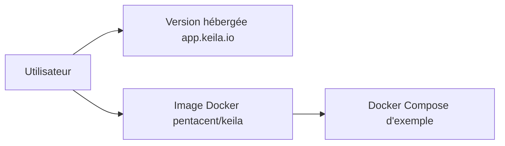

# pentacent/keila

> Newsletter and emailing tool, hosted or self-hosted via Docker.

## The problem
Sending email campaigns without depending on a closed service.

## What it actually does
Insufficient material: the README provided offers a hosted version (app.keila.io, pricing on the site), a `pentacent/keila` image and an example Docker Compose, and presents the mascot. No feature is described.

## How it is wired
Simplified diagram based on the sheet, no diagram provided.



## Trying it
```bash
# non documenté en commande : image Docker pentacent/keila ou docker-compose d'exemple du dépôt
```

## Cost and gotchas
Paid Cloud offering according to the site; self-hosting is free. AGPL-3.0.

## What it is not
Not described beyond installation: features to be checked in the documentation.

## Alternatives
No alternative named.

## For you
Ignore: emailing is outside data/AI/MLOps, README too thin to judge.
