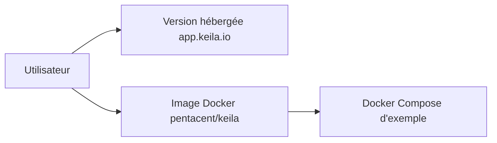

# pentacent/keila

> Outil d'envoi de newsletters et d'e-mailing, hébergé ou auto-hébergé via Docker.

## Le problème
Envoyer des campagnes d'e-mail sans dépendre d'un service fermé.

## Ce que ça fait vraiment
Matière insuffisante : le README fourni propose une version hébergée (app.keila.io, tarifs sur le site), une image `pentacent/keila` et un Docker Compose d'exemple, et présente la mascotte. Aucune fonction n'est décrite.

## Comment c'est branché
Schéma simplifié d'après la fiche, sans diagramme fourni.



## Essayer
```bash
# non documenté en commande : image Docker pentacent/keila ou docker-compose d'exemple du dépôt
```

## Coût et pièges
Offre Cloud payante selon le site ; auto-hébergement gratuit. AGPL-3.0.

## Ce que ce n'est pas
Pas décrit au-delà de l'installation : fonctions à vérifier sur la documentation.

## Alternatives
Aucune alternative nommée.

## Pour toi
Ignorer : e-mailing hors data/IA/MLOps, README trop pauvre pour juger.

