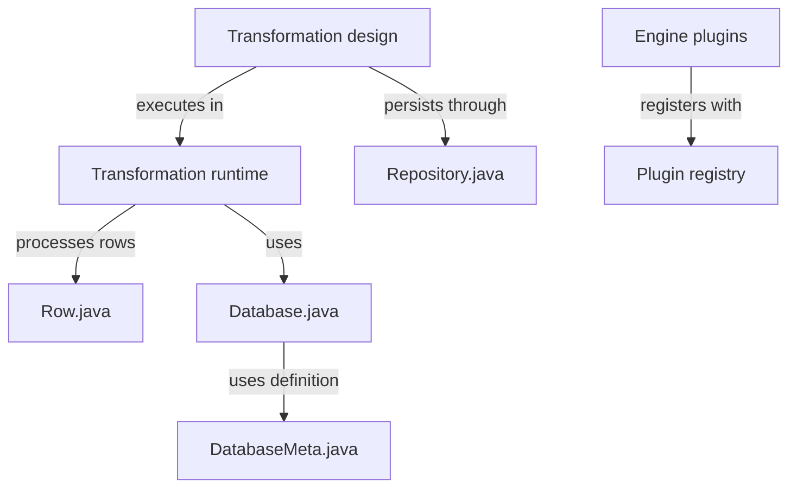

# pentaho/pentaho-kettle

> Pentaho Data Integration (Kettle): Java ETL engine for designing and running data transformations.

## The problem
Moving and transforming rows of data between databases and services without hand-writing scripts for every flow.

## What it actually does
The README only describes the Maven structure (core, engine, engine-ext, ui, dbdialog, plugins, integration) and the build. From the code: you define a transformation, the engine runs it by passing typed rows through steps, with database access via dialects, a repository to save jobs and transformations, and plugins.

## How it is wired


## Trying it
```bash
mvn clean install
mvn clean package
mvn test
mvn verify -DrunITs
```

## Cost and gotchas
Free. Requires Maven 3+, JDK 11 and a settings.xml file in ~/.m2 (not provided here). The README does not say how to launch the application once built, apart from the archive produced in assemblies/client/target.

## What it is not
Not a usage guide: the README is a build guide. The license is present but not identified by GitHub. The main execution path is not documented in the material provided.

## Alternatives
No alternative named in the README.

## For you
Worth watching: mature graphical ETL (repository from 2013, active), useful if you inherit Kettle flows; otherwise, a heavy Java/Maven build with no usage documentation here.
