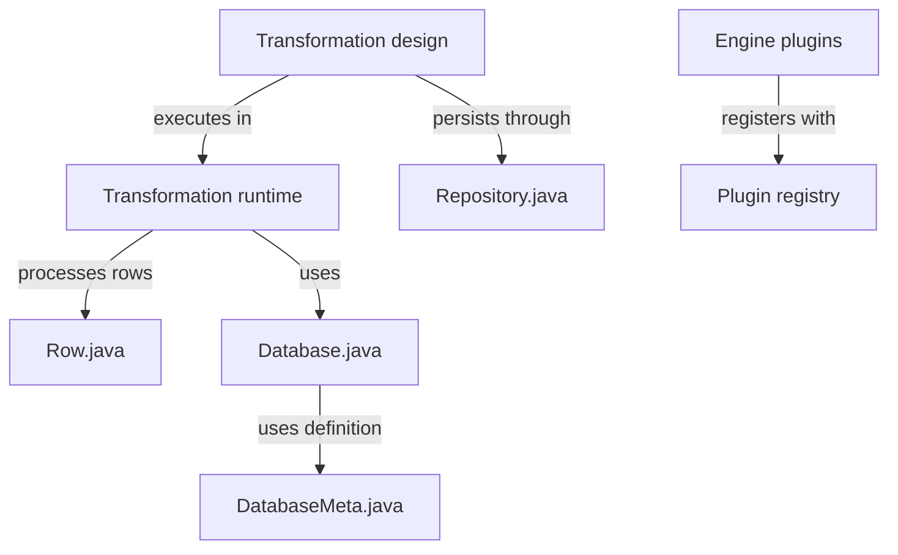

# pentaho/pentaho-kettle

> Pentaho Data Integration (Kettle) : moteur ETL Java pour concevoir et exécuter des transformations de données.

## Le problème
Déplacer et transformer des lignes de données entre bases et services sans écrire des scripts à la main pour chaque flux.

## Ce que ça fait vraiment
Le README ne décrit que la structure Maven (core, engine, engine-ext, ui, dbdialog, plugins, integration) et la compilation. D'après le code : on définit une transformation, le moteur l'exécute en faisant passer des lignes typées par des étapes, avec accès aux bases via des dialectes, un dépôt pour sauvegarder jobs et transformations, et des plugins.

## Comment c'est branché


## Essayer
```bash
mvn clean install
mvn clean package
mvn test
mvn verify -DrunITs
```

## Coût et pièges
Gratuit. Il faut Maven 3+, JDK 11 et un fichier settings.xml dans ~/.m2 (non fourni ici). Le README ne dit pas comment lancer l'application une fois construite, hormis l'archive produite dans assemblies/client/target.

## Ce que ce n'est pas
Pas un guide d'utilisation : le README est un guide de build. La licence est présente mais non identifiée par GitHub. Le chemin d'exécution principal n'est pas documenté dans la matière fournie.

## Alternatives
Aucune alternative nommée dans le README.

## Pour toi
À surveiller : ETL graphique mature (dépôt de 2013, actif), utile si tu hérites de flux Kettle ; sinon, un build Java/Maven lourd sans documentation d'usage ici.

