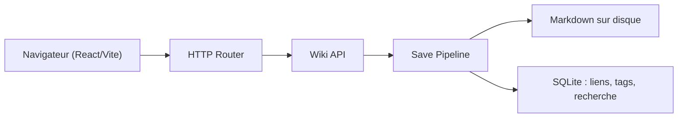

# perber/leafwiki

> Self-hosted wiki as a single Go binary, Markdown on disk and SQLite, for engineering docs.

## The problem
Wiki.js or Outline are heavy to operate for simple, lasting documentation.

## What it actually does
A single binary (embedded React UI), pages in Markdown on disk, SQLite for state. Tree navigation, manual ordering, full-text search, tags, backlinks, broken links, editor with preview, Mermaid, KaTeX, history, ZIP import (Obsidian style), JWT auth with roles, proxy header auth, snapshots, Git backup (experimental), SMTP.

## How it is wired


## Trying it
```bash
docker run -p 8080:8080 -v ~/leafwiki-data:/app/data \
  ghcr.io/perber/leafwiki:latest \
  --jwt-secret=yoursecret --admin-password=yourpassword --allow-insecure=true
```

## Cost and gotchas
Free. `--disable-auth` opens everything to editing: never on the Internet. A misconfigured `--login-url` locks out even admins. Without known_hosts, SSH Git backup no longer verifies the host.

## What it is not
Not real-time collaborative editing, not a Confluence/Notion replacement, no enterprise permissions (the README says so). The Mobile section is empty.

## Alternatives
The README names Wiki.js and Outline (more complete, heavier to operate).

## For you
Keep an eye on it: handy for lightweight MLOps runbooks or a team notebook; off-topic for modelling.
