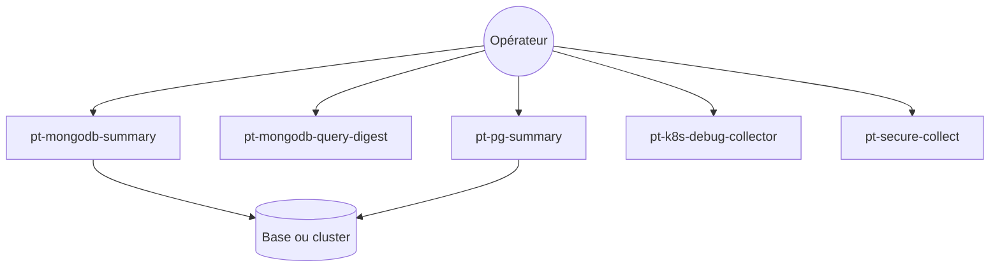

# percona/percona-toolkit

> Percona's collection of command-line tools for diagnosing MySQL, MongoDB, PostgreSQL and the system.

## The problem
Diagnosing a database (slow queries, unused indexes, Galera replication) calls for fragile homegrown scripts, never tested or documented.

## What it actually does
Standalone tools developed by Percona's support team. The Go code shown covers: MongoDB query summary and digest, unused index check, PostgreSQL summary, Galera log explanation, Kubernetes debug collection, and secure collection (cleaning then encrypting a support bundle).

## How it is wired


## Trying it
```bash
man percona-toolkit
man tool
```
Installation goes through the Percona repository, an archive or compilation: see the INSTALL file.

## Cost and gotchas
Free. You need access to the target database or cluster. Bugs are reported in Percona's Jira with the command line, the version and the error output.

## What it is not
Not a continuous monitoring platform: these are one-off tools run by hand. Not a single program, but separate tools.

## Alternatives
No alternative named in the README.

## For you
Worth watching: useful if you administer MySQL, MongoDB or PostgreSQL behind your data pipelines, of no direct interest for models; the GPL-2.0 license is only a concern if you redistribute the code.
